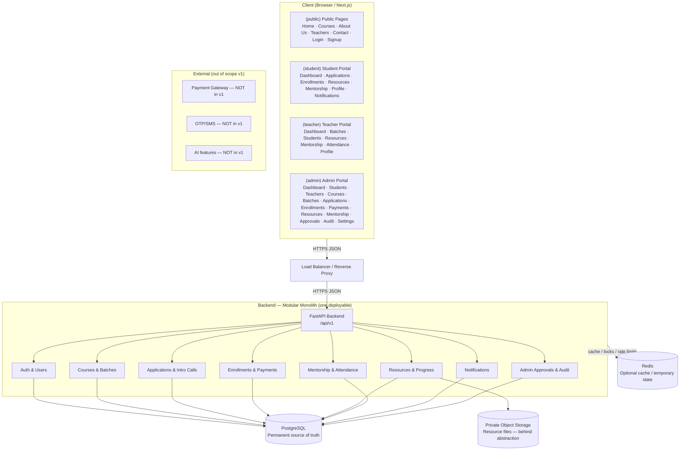
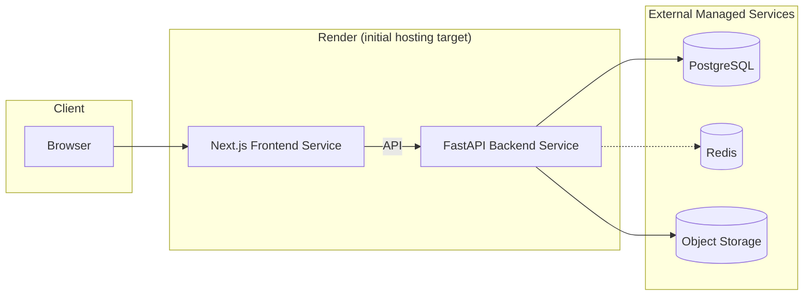

# Mentora System Architecture

**Status:** Phase 0 — Architecture review document (pre-implementation)  
**Product:** Mentora — JEE preparation platform  
**Audience:** Students in Classes 9–12  
**Rule:** Do not implement application features until this document is approved.

---

## 1. Context and Component Diagram

---

## 2. Frontend / Backend Boundaries

| Layer | Responsibility | Technology |
|-------|---------------|------------|
| **Frontend** | UI rendering, client-side routing, form handling, optimistic updates, theme switching, resource download links | Next.js App Router, React, JavaScript |
| **API contract** | REST JSON over HTTPS under `/api/v1`; OpenAPI spec auto-generated by FastAPI | FastAPI + Pydantic |
| **Backend** | Authentication, authorization, business logic, persistence, capacity checks, approval workflows, file serving via signed URLs | FastAPI, SQLAlchemy 2.x, Alembic, PostgreSQL, Redis |

**Key enforcement rule:** The backend is the sole authority for authentication, authorization, capacity, enrollment access, approvals, and resource access. The frontend never connects directly to PostgreSQL or Redis. Authorization is never hidden only in the UI.

---

## 3. Module Responsibilities (Backend)

One deployable FastAPI application, divided into domain modules:

| Module | Responsibility |
|--------|---------------|
| `auth` | User registration, login, logout, password hashing (Argon2id), session/token handling, Student ID generation |
| `users` | User CRUD, profile management, role assignment, normalization of email/phone |
| `courses` | Course CRUD, exam date/price, seed data (Rise, Spark, Apex), public course listing |
| `batches` | Batch CRUD, capacity, dates, schedule, status, batch-teacher assignment |
| `applications` | Batch application creation, application lifecycle, seat reservation |
| `introductory_sessions` | Auto-created intro-call record, scheduling, rescheduling, completion, 7-day deadline |
| `enrollments` | Enrollment lifecycle (PENDING_PAYMENT → ACTIVE → EXPIRED/CANCELLED/REJECTED), expiry at exam_date + 7 days |
| `payments` | Manual payment record by Admin, discount, final amount, payment method, reference |
| `resources` | Course → Module → Chapter → Resource hierarchy, draft/publish/unpublish, deletion requests, file metadata |
| `progress` | Bookmarks, manual lesson completion, learning progress |
| `mentorship` | Weekly batch schedules, session occurrences, one-to-one bookings (teacher + Admin) |
| `attendance` | Weekly session attendance, one-to-one attendance |
| `notifications` | In-app notifications, read/unread state, event-driven creation |
| `approvals` | Two-Admin approval workflow, proposal, votes, execution, audit |
| `audit` | Audit logs for Admin operations |
| `admin` | Admin dashboard metrics, cross-cutting Admin management |

Shared infrastructure (`core/`): `config.py`, `database.py`, `security.py`, `permissions.py`, `redis.py`, `storage.py`, `logging.py`.

---

## 4. External Services

| Service | Role | v1 Status |
|---------|------|-----------|
| PostgreSQL | Permanent source of truth for all records | Required |
| Redis | Cache (course lists, dashboards, unread counts, rate limits, temporary locks); never the only source of truth | Optional; graceful degradation if unavailable |
| Private object storage | Resource file storage (PDFs, images); private bucket, served via short-lived signed URLs after backend authorization | Provider not finalized; abstraction layer required |
| Nginx | Reverse proxy for local development / possible future unified routing | Config available; not an always-on paid service unless needed |

---

## 5. Deployment Topology

- Render Free local filesystems are ephemeral — never used for permanent uploads.
- Render Free PostgreSQL expiry policy must be checked before production use; external managed PostgreSQL/Redis/object storage considered where free-tier constraints require it.
- Nginx configuration kept for local development or future unified routing; frontend API URL, backend CORS, and HTTPS configured correctly.

---

## 6. Failure / Degradation Behavior

| Failure | Degradation Strategy |
|---------|---------------------|
| Redis unavailable | Core business functions continue; cache misses hit PostgreSQL; unread counts may be stale |
| Object storage unavailable | Existing download links fail; uploads rejected with clear error; metadata remains in PostgreSQL |
| PostgreSQL unavailable | Application is read-only / unavailable; clear error state shown |
| Free service sleeps/pauses | Clear error states; no silent data loss |
| Two-Admin approval missing | Critical action does not execute; no bypass via frontend |

---

## 7. Technology Stack

| Layer | Choice | Source |
|-------|--------|--------|
| Frontend | Next.js, React, JavaScript | AGENTS.md §3, PRD §18 |
| Backend | Python, FastAPI | AGENTS.md §3, PRD §18 |
| Database | PostgreSQL | AGENTS.md §3, PRD §18 |
| ORM / Migrations | SQLAlchemy 2.x, Alembic | AGENTS.md §3, PRD §18 |
| Validation | Pydantic | AGENTS.md §3, PRD §18 |
| Cache / temporary state | Redis | AGENTS.md §3, PRD §18 |
| Reverse proxy | Nginx (local dev / optional unified routing) | AGENTS.md §3, PRD §18 |
| Containers | Docker, Docker Compose | AGENTS.md §3, PRD §18 |
| CI | GitHub Actions | AGENTS.md §3, PRD §18 |
| Hosting target | Render | AGENTS.md §3, PRD §18 |
| File storage | Abstraction; provider not finalized | AGENTS.md §3, PRD §18 |

---

## 8. Non-Negotiable Constraints from AGENTS.md

- No TypeScript (JavaScript only for frontend).
- No microservices (modular monolith).
- No payment gateway, OTP/SMS, assignment submission, live classroom streaming, or AI features in v1.
- Two initial Admin accounts with equal permissions; critical decisions require both distinct Admins.
- Backend owns auth, authorization, capacity, enrollment access, approvals, resource access.
- UUID primary keys where appropriate; UTC timestamps; Asia/Kolkata for user-facing display.
- Argon2id password hashing; never plain-text passwords; never hard-code default Admin password.
- Phone numbers are not unique (families may share).
- REST endpoints under `/api/v1`; OpenAPI documentation maintained.
- Database transactions for multi-step operations; row-level locking for concurrency-sensitive operations (batch seat reservations).