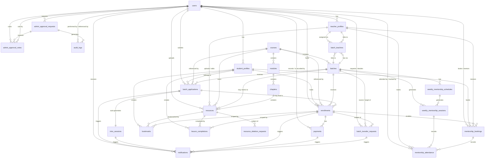

# Mentora Entity-Relationship Diagram

**Status:** Phase 0 — Architecture review document (pre-implementation)  
**Source of truth:** PRD §17 (Suggested data model) and AGENTS.md §5 (Data and time rules)

---

## 1. Mermaid ER Diagram

---

## 2. Entity Descriptions

| Entity | Description |
|--------|-------------|
| `users` | Core account identity (email, password hash, role, timestamps). One user may have a student profile and/or a teacher profile. Admin accounts are users with the Admin role. |
| `user_roles` | Role assignment lookup (Student, Teacher, Admin). A user can have one or more roles. |
| `student_profiles` | Student-specific details: Student ID (unique), class (9–12), school name, coaching institute, phone, normalized email link to users. |
| `teacher_profiles` | Teacher-specific details: assigned subjects/courses, bio (consent-based public visibility), phone (not shown to students). |
| `courses` | JEE courses: Rise (JEE Main Jan), Spark (JEE Main Apr), Apex (JEE Advanced). Editable exam date and price. |
| `batches` | Batch belongs to exactly one course. Name, description, start/end dates, weekly schedule, max capacity, status. |
| `batch_teachers` | Join table for many-to-many batch ↔ teacher assignment. |
| `batch_applications` | Student application to a batch. Separate from enrollment. Triggers intro-session creation. |
| `intro_sessions` | Introductory phone-call record auto-created per application. Status, scheduled time, outcome, follow-up. |
| `enrollments` | Enrollment lifecycle entity. States: PENDING_PAYMENT, ACTIVE, EXPIRED, CANCELLED, REJECTED. Expires at exam_date + 7 days. |
| `payments` | Manual payment record by Admin: student, course/batch, original amount, discount, final amount, status, date, method, reference, recording Admin. |
| `batch_transfer_requests` | Student-initiated batch transfer request: reason, original batch, requested batch, decision, responsible Admin, timestamps. |
| `modules` | Course contains modules. |
| `chapters` | Module contains chapters. |
| `resources` | Learning resource: PDF, image, assignment sheet, external video link, external document link, text lesson. Belongs to course, optional batch restriction, module/chapter, file or URL, uploader, status, timestamps. |
| `resource_deletion_requests` | Teacher requests deletion; Admin approves. |
| `bookmarks` | Student bookmarks a resource (many-to-many student ↔ resource). |
| `lesson_completions` | Student manually marks a lesson/resource complete (many-to-many student ↔ resource). |
| `weekly_mentorship_schedules` | Recurring weekly group session schedule per batch (Admin-managed). |
| `weekly_mentorship_sessions` | Individual session occurrences generated from schedules. |
| `mentorship_bookings` | One-to-one mentorship booking: student selects preferred assigned teacher, preferred/confirmed time, status, reason, attendance. |
| `mentorship_attendance` | Attendance for weekly sessions and one-to-one bookings. |
| `notifications` | In-app notifications, permanently stored in PostgreSQL. |
| `admin_approval_requests` | Critical-action proposal: requester, action type, payload snapshot, timestamps, execution status. |
| `admin_approval_votes` | Votes on approval requests by distinct Admins. Prevents duplicate/self double-approval. |
| `audit_logs` | Audit records for important Admin operations, referenced by user. |
| `activity_events` | Activity stream events (cached in Redis, permanent in PostgreSQL). |
| `application_settings` | Key-value store for configurable settings (intro session duration, critical-action list, brand tokens, etc.). |

---

## 3. Cardinalities

| Relationship | Cardinality | Notes |
|-------------|-------------|-------|
| User ↔ StudentProfile | 1:0..1 | A user may or may not have a student profile. |
| User ↔ TeacherProfile | 1:0..1 | A user may or may not have a teacher profile. Admin users have neither necessarily. |
| User ↔ Applications | 1:N | A student can have multiple applications. |
| User ↔ Enrollments | 1:N | A student can have multiple enrollments. |
| Course ↔ Batches | 1:N | A batch belongs to exactly one course. |
| Batch ↔ Teachers | N:M | Via `batch_teachers` join table. |
| Student ↔ Enrollments | 1:N | Multiple enrollments allowed, including multiple batches of same course. |
| Course ↔ Modules | 1:N | |
| Module ↔ Chapters | 1:N | |
| Chapter ↔ Resources | 1:N | |
| Resource ↔ Bookmarks | 1:N (student-scoped) | |
| Resource ↔ LessonCompletions | 1:N (student-scoped) | |
| Batch ↔ WeeklyMentorshipSchedules | 1:N | |
| Schedule ↔ Sessions | 1:N | |
| Application ↔ IntroSession | 1:1 | Auto-created exactly once per application. |
| Enrollment ↔ Payments | 1:N | |
| ApprovalRequest ↔ ApprovalVotes | 1:N | Two distinct Admins required for critical actions. |
| ApprovalVote ↔ User | N:1 | Vote cast by an Admin user. |

---

## 4. Important Constraints

- **UUID primary keys** where appropriate (users, profiles, courses, batches, applications, enrollments, payments, resources, bookings, approvals, etc.).
- **Student ID** is unique and system-generated.
- **Email** is normalized and unique.
- **Phone number** is validated and normalized but NOT unique (families may share).
- **No unique constraint on (student_id, course_id)** — multiple enrollments in the same course are allowed.
- **No unique constraint on (student_id, batch_id) for active enrollments** is proposed as default (prevent duplicate active enrollment for same student/batch) but must be confirmed with product owner before enforcing (PRD open question #13).
- **Batch capacity** must not be exceeded; enforced via PostgreSQL transactions and row-level locking.
- **Pending-payment and active enrollments reserve seats.**
- **Release reserved seat** when application/enrollment is rejected or cancelled.
- **Enrollment expiry:** `access_until = exam_date + 7 days`.
- **Opening a resource does not auto-mark complete** — manual student action only.
- **Teacher deletion requires Admin approval** — enforced via `resource_deletion_requests` + `admin_approval_requests`.
- **Admin unpublish** takes effect immediately.
- **Two distinct Admins** required for critical actions; one Admin cannot approve twice.

---

## 5. Key Relationship Notes

### Enrollment → Application → Batch
A student applies to a batch (`batch_applications`). An application may lead to an enrollment (`enrollments`) after Admin records payment and activates. Applications and enrollments are separate entities (PRD §9.2). An enrollment references its batch and course directly for access control.

### Payment → Enrollment
Admin records a manual payment linked to a student + course/batch. Payment is a prerequisite for enrollment activation but is recorded separately. No payment gateway in v1.

### Booking → Mentorship
One-to-one mentorship bookings link a student to a mentor (teacher or Admin). Only teachers assigned to the student's relevant batch are selectable. Teacher approves/rejects their own booking; Admin can view/manage all.

### Approval → Votes → Execution
Critical actions require an approval request with votes from two distinct Admin accounts. Execution happens only after both approvals. Audit record written.